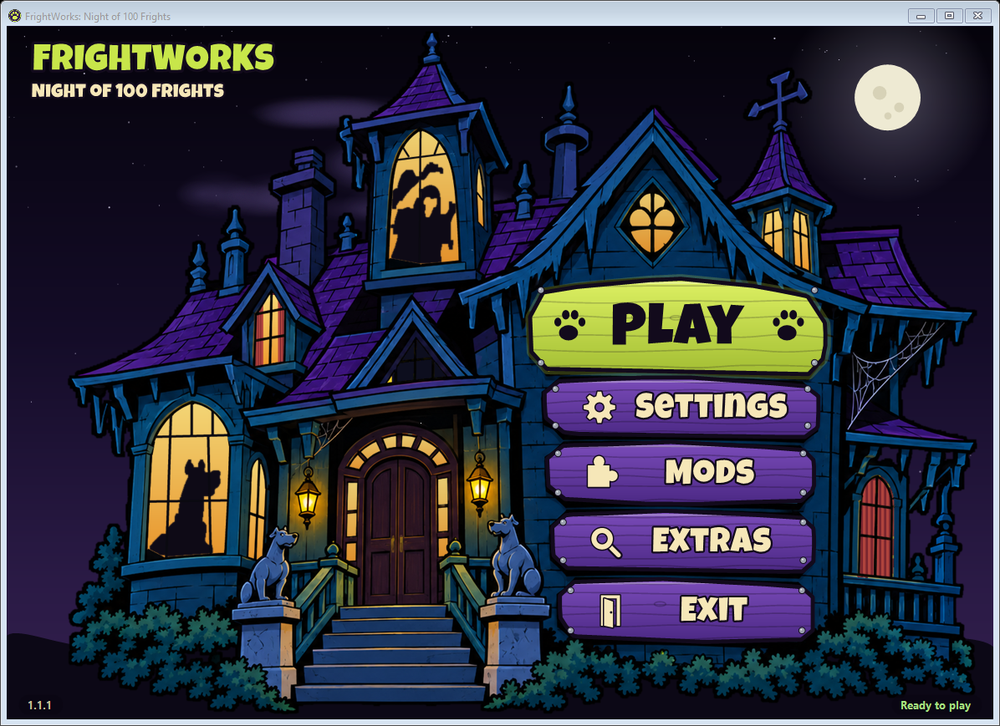

# FrightWorks: Night of 100 Frights

A statically recompiled PC port of **Scooby-Doo! Night of 100 Frights** (GameCube, 2002). The game's PowerPC code is
translated ahead of time to C++ with [WiiCompiled](https://github.com/patchzyy/Wiicompiled) and compiled into a Windows
program, so there is no CPU emulator; the console's graphics, audio and system calls are reimplemented underneath.

FrightWorks continues [Scooby-Doo: Refrightened](https://github.com/josiahg2502-glitch/Scooby-Doo-Refrightened) by JosiahG,
from which it split off on October 31, 2026. This repository is the GameCube version; ports of the other console versions
may follow.

> **Artists wanted:** the launcher needs new art in the style of the original show. [Details below](#wanted-an-artist-for-the-launcher).


<p>
  
  
  
</p>

## Features

- Up to 4K, true widescreen (16:9, fill, cinematic 2.39:1) or original 4:3
- 30 or 60 fps, MSAA anti-aliasing, HDR
- Added Creeper window animation from the XBOX edition of the game to the Mystic Manor's Mystery Machine courtyard
- Built-in HD texture pack (can be switched off)
- Gamepads and keyboard, remappable in the launcher (**Settings** > **Controls**) or in game (**F10** > Controls);
  button prompts match your Xbox, PlayStation or Nintendo controller and follow remapped face buttons
- Optional original Xbox controls: X head smash, B dig / talk and back in menus, LB soap bubble, RB sneak (together with
  the triggers, as on the Xbox); the button prompts and tutorial hints follow. Black and White can also go on other
  buttons. The launcher detects an Xbox controller and asks once which layout to use
- GameCube memory-card saves
- Option to skip the intro movies; mods that replace game files or textures
- The game's holiday events follow the real date, or pick a holiday or turn them off on the launcher's **Extras** page

**No game data is included.** You need your own disc image.

The courtyard animation reuses the retained GameCube textures and their original timing, keeping the
GameCube window colors. No Xbox image or imported assets are needed; existing nonempty material-map mods
are left unchanged.

## Playing

Requires Windows 10/11 (64-bit) and **Night of 100 Frights, GameCube USA v1.01 (GIHE78, revision 1)** as `.iso`,
`.gcm` or `.ciso`.

1. From the [latest release](https://github.com/FrightWorks/FrightWorks-no100f/releases/latest), run
   `FrightWorks-win-Setup.exe` (installs for your Windows user, no admin rights; Start menu and desktop shortcuts), or
   unzip `FrightWorks-<version>.zip` anywhere if you'd rather keep everything in one folder.
2. Open **FrightWorks** and press **Play**. The first time, it asks for your disc image (**Extras**).

Windows may warn that the setup is from an unknown publisher (it isn't code-signed): **More info** > **Run anyway**.

**Updates.** The installed game looks for a new version when the launcher starts and asks before updating (**Extras >
Updates** turns that off, or checks right away). Updating keeps your saves and settings. The zip can't update itself:
its launcher tells you when a new release is out; unzip it over the old folder.

**Where your files are**

| | Installed | Zip |
| --- | --- | --- |
| Saves | `Saved Games\FrightWorks` | `data\UserData\Saves` |
| Settings, mods, logs, game files from your disc | `%LOCALAPPDATA%\FrightWorks-Data` | `data\UserData`, `data\Disc` |
| Screenshots (**F2**) / videos (**F3**) | `Pictures\FrightWorks` / `Videos\FrightWorks` | `Screenshots` / `Videos` beside the launcher |

**Extras > Folders** opens these, can put the saves in another folder (say, one that's backed up), and copies saves and
settings over from an earlier FrightWorks or Refrightened folder. Uninstalling (Windows Settings > Apps) removes the
program only; your saves and settings stay.

Settings are in the launcher (**Settings**) and in game (**F10**, or the controller's **Back** / **Select** button, as
long as no mapping uses it). **F11** toggles fullscreen, **F2** saves a
screenshot and **F1** opens this page in your browser. The title screen and main menu list
these keys in the corner. With more than one monitor, **Settings** > **Display** > **Fullscreen monitor** (or **F10** >
Video) picks the one fullscreen uses.

For testing: **Extras > Developer tools** in the launcher turns on the **F8** dev menu (go to any level, saved spots,
free camera, god mode, power-ups on/off, texture finder), **F3** video recording of the game (needs
[ffmpeg](https://ffmpeg.org): the launcher offers to download it when you turn the tools on) and a **DEV** mark with the
build in the corner of the game. The build (version,
branch and commit of a test build) is also on the F10 **About** page and at the top of `console.log`.

Coming from an earlier zip of FrightWorks or from Scooby-Doo: Refrightened? On first start, the launcher looks for the
old folder (beside the new zip, or for the installed game in Downloads, Desktop and Documents) and offers to copy your
saves, settings, controls, mods and game files over; the old folder is left as it is. If it isn't found, use **Extras >
Folders > Copy from an earlier version**.

**Version numbers** continue from Scooby-Doo: Refrightened. Its last release, v1.0.2, is the commit FrightWorks split
off from, so FrightWorks starts at v1.0.3.



## Wanted: an artist for the launcher

The launcher's haunted-mansion art is a placeholder. It was made with AI to work out how the launcher should look and
behave: the signs are the menu, the windows light up, curtains move and silhouettes pass by. It does the job, but the
goal is to have a real artist redraw it, closer to the look of the original *Scooby-Doo, Where Are You!*: painted
backgrounds, spooky colors, a creepy old mansion on a stormy night.

What's needed:

- The mansion on a transparent background, with the window glass cut out (the launcher draws the lights, curtains and
  silhouettes behind the house)
- Five signs for the menu
- Silhouettes for the windows. They shouldn't show the characters directly, but should look a bit like them: mainly
  Scooby and Shaggy, and the rest of the gang is welcome too. One that looks like the Mastermind would be great, and
  any of the monsters are welcome.

The current pieces are in [`launcher/art`](launcher/art), so you can see the sizes and layout.

The artist will be credited here, on the launcher's About page, on the in-game credits screen and in the release
notes. If you're interested, email [therider@unmarkedrider.com](mailto:therider@unmarkedrider.com).

## Building

Windows 10/11 x64 with Python 3 and Git. The build downloads its own toolchain into the repo.

```powershell
powershell -ExecutionPolicy Bypass -File tools\build-launcher.ps1
& "launcher\publish\FrightWorks.exe" --extract "C:\path\to\game.iso" Disc\DATA
powershell -ExecutionPolicy Bypass -File tools\build-no100f.ps1
powershell -ExecutionPolicy Bypass -File tools\package-scooby.ps1 -Zip          # or -Installer (Velopack)
```

The game builds to `Play\`; the package goes to `dist\`. The first build downloads dogerki's HD texture pack
(604 MB, from the [Internet Archive](https://archive.org/details/dolphin-scooby-doo-night-of-100-frights-hd-texture-pack))
into `texture_pack\ScoobyHD` (not in git) and adds the HD Creeper frames from `tools\hd-pack-additions`. Every build
copies the pack and the button prompt icons into `Play\` beside the game; the icons need Python and ImageMagick.

**Linux** (x86_64, a native build; no release package yet). Needs clang, Ninja, Python 3 with Pillow, ImageMagick,
curl, rsync and bsdtar (or 7z / unrar); SDL3 for controller detection in the launcher. CMake and the .NET 10 SDK are
downloaded into `toolchain/`.

```sh
tools/build-no100f-linux.sh /path/to/game.iso   # extracts the disc the first time, then builds the game into Play/
tools/build-launcher.sh                         # the launcher: launcher/publish/FrightWorks
launcher/publish/FrightWorks                    # or start the game directly: "Play/FrightWorks Game"
```

On Linux the game doesn't record F3 videos or pick a fullscreen monitor yet, so the launcher leaves those out.

Tests, playtest sessions and the debug tools (dev menu, logs, scripted input): [`docs/testing.md`](docs/testing.md).

## Credits

- FrightWorks: Loneranger419
- Fright Wrangler, Master of Mysteries, and Scooby Snack Technician - [BitsofBitsofBits](https://github.com/BitsofBitsofBitsofBits)
- Original port, [Scooby-Doo: Refrightened](https://github.com/josiahg2502-glitch/Scooby-Doo-Refrightened): JosiahG
- [WiiCompiled](https://github.com/patchzyy/Wiicompiled) by patchzyy and contributors (GPLv3); Aurora by Luke Street
  (MIT); other components in [`wiicompiled/THIRD-PARTY-NOTICES.md`](wiicompiled/THIRD-PARTY-NOTICES.md)
- HD texture pack by **dogerki**
  ([Dolphin forums](https://forums.dolphin-emu.org/Thread-scooby-doo-night-of-100-frights-hd-texture-pack-ai))
- Button prompts from [Kenney's Input Prompts](https://kenney.nl/assets/input-prompts) (CC0)
- Launcher and in-game menu lettering: [Luckiest Guy](https://fonts.google.com/specimen/Luckiest+Guy) by Astigmatic
  (Apache 2.0); in-game menu text: [Roboto](https://fonts.google.com/specimen/Roboto) by Christian Robertson (Apache 2.0)

## License

GPLv3 ([`LICENSE`](LICENSE)); bundled components keep their own licenses. FrightWorks is a modified version of
Scooby-Doo: Refrightened by JosiahG, changed by Loneranger419 from 2026-10-31 on (the git history lists every change).

Not covered by the GPL (these stay under their owners' terms):

- `launcher/fonts/LuckiestGuy-Regular.ttf` and `wiicompiled/runtime/assets/fonts/LuckiestGuy-Regular.ttf`: the Luckiest
  Guy font by Astigmatic, Apache License 2.0 ([`launcher/fonts/LuckiestGuy-LICENSE.txt`](launcher/fonts/LuckiestGuy-LICENSE.txt))
- `wiicompiled/runtime/assets/fonts/Roboto-Medium.ttf`: the Roboto font by Christian Robertson, Apache License 2.0
- `docs/`: screenshots of the game and the launcher

Scooby-Doo ™ & © Hanna-Barbera / Warner Bros. Night of 100 Frights © THQ / Warner Bros. Interactive, developed by
Heavy Iron Studios. Unofficial fan project, not affiliated with or endorsed by them. The repository contains no game
code or assets; the game's data is read from your own copy.
